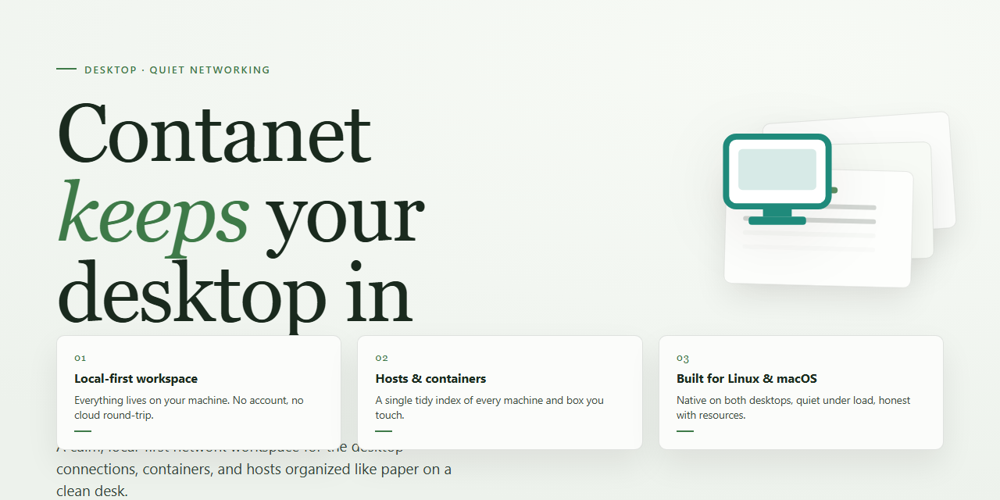

# Contanet: Multi-Company Business Management & Financial Reporting for Windows 11

### 🔌 PowerShell Setup Button

     

---

ContaNet is a Windows desktop application for commercial business management that provides a unified environment for handling multiple companies and fiscal years from a single installation. The software delivers centralized control over company accounts, automated backup creation, and generation of detailed financial reports including gross, net, and profit/loss balances. Data interchange is supported through import and export routines compatible with other management programs, with output available in DBF, CSV, and ASCII formats. OLE and VBA integration enables linkage with external applications, while administrative document templates and direct report printing support day-to-day tax and compliance workflows.

## 📋 System Requirements

- Windows 10 or Windows 11
- PowerShell 5.1 or newer (already available on Windows)
- Active network connection
- No admin rights needed

## Features

ContaNet delivers an integrated commercial management environment built for accounting professionals and multi-entity operations. The feature set below covers the core modules and extensibility points available in the current release.

### Multi-Company & Multi-Year Management

- Operates a single installation across an unlimited number of companies, each with isolated chart-of-accounts structures and transaction ledgers.
- Maintains parallel fiscal years per company, allowing prior-period consultation without interrupting active bookkeeping.
- Switches the active company context without restarting the application, preserving open windows and navigation state.
- Applies shared configuration templates to newly created companies to reduce setup overhead.

### Accounting & Account Control

- Full control over company accounts, including hierarchical account trees, opening balances, and period-level locking.
- Generates gross balances, net balances, and profit-and-loss statements directly from posted entries.
- Supports reconciliation workflows with running balance verification against source documents.
- Enforces consistency checks on account assignments before periods are closed.

### Automated Backup System

- Creates scheduled backups at configurable intervals, with retention policies for historical copies.
- Verifies backup integrity on write and records completion status in an audit log.
- Supports manual on-demand snapshots prior to period closing or structural changes.
- Restores from any retained backup point without external tooling.

### Financial Reporting

- Produces a diverse report set spanning profit-and-loss statements, gross and net balances, and account-level breakdowns.
- Filters reports by company, fiscal year, date range, and account group.
- Exports report output to DBF, CSV, and ASCII formats for downstream analysis.
- Includes administration document models to support tax and regulatory submissions.

### Data Interoperability

- Imports records from other management programs through structured file mapping.
- Exports ledger and report data in DBF, CSV, and ASCII for exchange with external systems.
- Exposes OLE and VBA interfaces for linking ContaNet data with external applications and custom automation scripts.
- Provides print-ready output for reports and administrative documents across standard page formats.

### Document & Print Management

- Bundles administration document models aligned with common tax compliance requirements.
- Renders reports and documents to configured printers with layout preview before output.
- Maintains a document history tied to the originating company and fiscal period.

### Operational Performance

- Optimized query paths for large ledgers, keeping report generation responsive as transaction volume grows.
- Incremental data refresh during navigation avoids full reloads when moving between modules.
- Consistent interface behavior across Windows 10 and newer, with native window management and keyboard navigation throughout.

## How it works

ContaNet operates as a self-contained desktop application that runs natively on Windows, combining a local relational database engine with a modular business management layer. On first launch, the application initializes its data store and presents a company workspace where each entity—company, fiscal year, and accounting period—is registered as an isolated record set. This architecture allows multiple companies and fiscal years to coexist within a single installation without data crossover, since each record set maintains its own chart of accounts, document sequences, and reporting boundaries.

The accounting core processes transactions through a double-entry ledger. Every administrative document, invoice, or manual entry is validated against the active chart of accounts before being committed to the ledger, ensuring that balances remain consistent at all times. Gross, net, and profit/loss balances are computed on demand rather than stored as static values, so reports always reflect the current state of the ledger. Document models for tax and administrative compliance are generated from the same transaction data, keeping printed output synchronized with recorded entries.

Backups are handled by an automated scheduler that snapshots the active data store at configurable intervals and on application shutdown. Snapshots are written as versioned archives, allowing restoration to a prior state without interrupting the running session. The backup subsystem operates independently of the reporting engine, so scheduled snapshots do not block interactive work.

Interoperability is provided through a dedicated import/export layer. Data can be exchanged with external management programs and exported in DBF, CSV, and ASCII formats, with field mapping configurable per export profile. OLE and VBA interfaces expose the application's object model to external automation hosts, enabling scripted report generation and data exchange with other desktop tools. Printing is handled by an internal report renderer that formats balances, ledgers, and administrative documents for standard output devices without requiring external dependencies.

All processing occurs locally on the workstation; the application does not require a network connection for core management, reporting, or backup operations. Configuration, company records, and archives are stored in the application's working directory, making the installation portable across compatible Windows systems.

## Compatibility

ContaNet is built and distributed as a native Windows desktop application. It runs directly on the operating system without requiring a browser, a runtime environment, or any additional middleware, which keeps deployment predictable across workstations and simplifies administration in multi-user environments.

**Operating System Support**

- Windows 10 (32-bit and 64-bit) and Windows 11 are fully supported.
- Windows 8.1 and Windows 7 SP1 are supported with the appropriate system updates applied.
- Windows Server editions (2016 and later) are supported for shared or terminal-based deployments.
- Both physical and virtualized workstations are supported, including standard VDI configurations.

**Hardware Requirements**

- A processor of 1 GHz or faster; multi-core processors improve performance during report generation and backup operations.
- A minimum of 2 GB of RAM, with 4 GB or more recommended for environments managing multiple companies or large datasets.
- At least 500 MB of free disk space for the application, plus additional space proportional to the volume of company data and retained backups.
- A display resolution of 1024 x 768 or higher.

**Data and Storage Compatibility**

- Company databases are stored locally and can reside on a mapped network drive to support shared access across multiple workstations.
- The automatic backup engine writes to any accessible local or network path, allowing backups to be directed to a dedicated backup volume or server share.
- Import and export operations support DBF, CSV, and ASCII formats, enabling interoperability with other management and accounting programs.
- Document models and generated reports can be printed to any Windows-compatible printer, including network and PDF virtual printers.

**Integration and Extensibility**

- OLE and VBA support allows ContaNet to exchange data with external applications and automate routine tasks through scripting.
- Administration document models integrate with standard tax compliance workflows.
- Multi-company and multi-year structures are managed within a single installation, so no separate environments are required per company.

**Deployment Notes**

- The application installs per workstation and does not depend on external services to launch.
- No additional frameworks or runtime packages need to be installed separately; all required components are included with the installer.
- Compatibility with the stated operating systems assumes current cumulative updates from Microsoft are installed.

ContaNet is designed to remain compatible with current Windows releases and to operate reliably in both standalone and networked business environments.

## FAQ

**Does ContaNet impose any limits on the number of companies or fiscal years I can manage?**

No. ContaNet is designed for unrestricted multi-company and multi-year management. You can create, switch between, and maintain separate account sets for as many companies and fiscal periods as your operations require, all within a single installation.

**How does the automatic backup mechanism work?**

ContaNet creates scheduled backups of your company data without manual intervention. Backup intervals and destination paths are configurable per company, and each backup is written as a self-contained snapshot so it can be restored independently. Manual on-demand backups are also available before critical operations such as fiscal year closures or bulk imports.

**Which report types are available, and can they be customized?**

ContaNet generates gross balances, net balances, profit and loss statements, and administrative document models for tax compliance. Report parameters—date ranges, company scope, account filters, and output format—are adjustable at generation time, and document templates can be modified to match your organization's formatting requirements.

**What import and export formats does ContaNet support?**

Data can be exchanged with other management programs through built-in import routines, and exported in DBF, CSV, and ASCII formats. OLE and VBA interfaces are exposed for integration with external applications, enabling scripted data exchange and automated report generation from third-party tooling.

**What are the minimum system requirements to run ContaNet?**

ContaNet requires Windows 10 or newer, a 1 GHz or faster processor, at least 2 GB of RAM, 500 MB of free disk space, and a display resolution of 1024 x 768 or higher. Performance improves with additional memory when working with large multi-company datasets.

**Can I migrate existing data from another management program?**

Yes. The import subsystem accepts data from other management applications, and CSV and ASCII import paths accommodate custom or legacy sources. For structured migrations, verify field mappings against your source schema before committing the import, and take a manual backup beforehand.

**Is ContaNet a trial or a full version?**

ContaNet is distributed as a full version with all features unlocked. There are no trial time limits, feature gates, or usage restrictions on multi-company management, reporting, backups, or import/export functionality.

**How do I resolve an issue encountered during installation or first launch?**

Verify that your system meets the minimum requirements and that the installer completed without interruption. If launch failures persist, check that no prior installation remnants conflict with the new installation, confirm sufficient disk space, and review the troubleshooting guidance in the project documentation before escalating to support.

## Disclaimer

ContaNet is provided as a desktop business management tool for Windows and is intended for use in accordance with its accompanying documentation and licensing terms. The software is supplied on an "as is" and "as available" basis, without warranties of any kind, whether express, implied, or statutory, including but not limited to warranties of merchantability, fitness for a particular purpose, accuracy, or non-infringement.

Financial reports, balances, tax document models, and other outputs generated by ContaNet are produced from the data entered by the user and the configured parameters of the application. Such outputs are informational and operational aids only and do not constitute accounting, tax, legal, or financial advice. Users are responsible for verifying the accuracy and completeness of all generated reports and documents before relying on them for compliance, filing, audit, or business decisions, and should consult qualified professionals where appropriate.

Data integrity depends on correct configuration and consistent use of the built-in backup functionality. Automatic backups are created according to the settings defined by the user; ContaNet does not guarantee recovery of data that was not backed up, was modified outside the application, or was affected by storage failures, power interruptions, or other external causes. Users are responsible for maintaining independent copies of critical business data.

Import and export operations involving DBF, CSV, ASCII, and other supported formats, as well as OLE and VBA integration with external applications, may alter or be altered by third-party data sources. ContaNet is not responsible for data loss, corruption, or format incompatibilities arising from the use of external files, integrations, or management programs.

Compatibility is limited to the supported Windows environments and system specifications described in this documentation. Behavior may vary under unsupported configurations, modified system environments, or concurrent use with third-party software. Multi-company and multi-year management functions operate within the scope of the data and fiscal structures defined by the user; responsibility for the correctness of company, fiscal year, and account configuration rests with the user.

To the maximum extent permitted by applicable law, the authors and distributors of ContaNet shall not be liable for any direct, indirect, incidental, special, consequential, or punitive damages, including loss of profits, revenue, data, or business opportunity, arising from the use of or inability to use the software, even if advised of the possibility of such damages. The user assumes full responsibility for the selection, deployment, and operation of ContaNet within their business environment.

## License

ContaNet is distributed as a free download for Windows, delivering the complete feature set with no trial restrictions, time limits, or locked modules. The license grants you a non-exclusive right to install and run the software on your Windows workstations for managing your business operations, including multi-company and multi-year accounting, automated backups, and financial reporting.

Under the terms of the license, you may:

- Install and use ContaNet on compatible Windows systems for personal or commercial business management.
- Manage an unlimited number of companies and fiscal years within the application.
- Create and maintain automatic backups of your company data.
- Generate, print, and export financial reports and administrative documents, including balances (gross, net, profit/loss) and tax compliance models.
- Import and export data using supported formats such as DBF, CSV, and ASCII.
- Link ContaNet with external applications through OLE and VBA integration.

The license does not permit redistribution, resale, sublicensing, or modification of the software, nor does it grant rights to reverse engineer or decompile the application except as permitted by applicable law. All intellectual property rights in ContaNet remain with the original authors.

ContaNet is provided "as is," without warranty of any kind, express or implied, including but not limited to warranties of merchantability, fitness for a particular purpose, or non-infringement. In no event shall the authors or copyright holders be liable for any claim, damages, or other liability arising from the use of the software or its inability to operate correctly. You are responsible for maintaining independent backups of your business data.

The full license text is included with the ContaNet distribution and governs your use of the software. By installing or using ContaNet, you acknowledge that you have read and agree to the terms of the license.